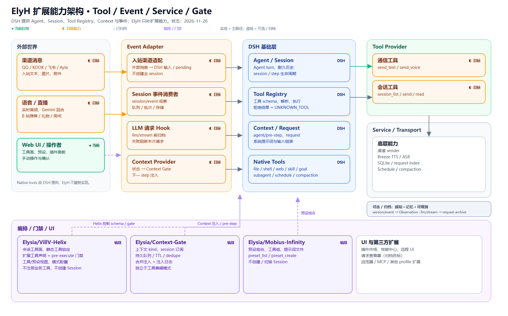

# ElyH 扩展能力架构

> 状态：2026-11-26。本文是当前架构的唯一总览。
>
> 旧文档中“主意识插件”“潜意识插件”“capability-core/capability-panel”的写法已经过时；旧代码已归档到
> [`plugins/_archive-elysia-v1/`](../plugins/_archive-elysia-v1/README.md)。旧文只作为迁移参考，不再定义当前实现。
>
> 相关文档：
> [插件开发规范](architecture/elyh-plugin-spec.zh.md) ·
> [扩展组件架构](architecture/elyh-plugin-architecture.zh.md) ·
> [工具面与控制面板](architecture/elyh-control-panel.zh.md) ·
> [上下文事件门](architecture/elyh-context-gate.zh.md) ·
> [预设管理](architecture/elyh-preset-manager.zh.md) ·
> [旧实现迁移映射](architecture/elyh-legacy-migration.zh.md)



## 1. 边界

DSH 已经提供 Agent、Session、Tool Registry、Context 注入、事件、调度、压缩、文件、Shell、Web、Skill、Subagent 等基础能力。

**ElyH 不重新实现这些基础工具。** ElyH 只做扩展层：

```text
DSH 基础层
  Agent / Session / Tool Registry / Context / Events / Schedule / Compaction
        │
        ▼
ElyH 扩展层
  渠道消息 / 会话通信 / 语音媒体 / 感知记忆 / 可观测 / 编排与预设
```

因此，架构文档不再逐项罗列 DSH 原生工具。它们只在某个扩展依赖时被引用。

## 2. 扩展插件只有两类外向形态

### 2.1 Tool Provider

注册模型可调用的工具。

- 工具在插件挂载时注册，卸载时 dispose。
- 工具不维护插件私有开关。
- 工具是否可执行由当前工具面 / 门禁决定。
- 没有编排插件时，工具仍是普通工具。

### 2.2 Event Adapter

连接外部事件或 DSH 生命周期事件，并产生以下一种或多种结果：

- 注入模型可见上下文；
- 触发一次 Agent turn；
- 调用一个工具；
- 写入队列 / 存储；
- 通知 UI。

Event Adapter 可以是：

- **Event Source**：外部渠道、语音、直播、计划到期；
- **Event Consumer**：监听 `session/event`、`llm/stream`、`tools/change` 等；
- **Context Provider**：把外部或内部状态转成模型可见上下文。

底层发送器、TTS、ASR、SQLite、索引属于 **Service/Transport**，不是模型工具。

## 3. 能力域

### A. 渠道消息

| 项 | 内容 | 当前状态 |
|---|---|---|
| 工具 | `send_text`、`send_voice` | 目标能力；旧实现已归档 |
| 事件 | QQ / KOOK / 飞书 / Ayla 入站消息 | 目标能力；旧实现已归档 |
| 服务 | 各渠道 sender、Breeze TTS | 目标能力；旧实现已归档 |
| 旧实现 | `conscious-mind` 的发送部分 + 渠道插件 | 归档 |

这是一条 **Event Adapter → DSH Agent → Tool Provider → Channel Service** 的链路，不存在“主意识插件”。

### B. 会话间通信

| 项 | 内容 | 当前状态 |
|---|---|---|
| 工具 | `session_list`、`session_send`、`session_read` | 目标能力；旧实现已归档 |
| 事件 | 内部消息投递、回复关联、投递证据 | 目标能力；旧实现已归档 |
| 服务 | 通讯存储、附件转交、历史查询 | 目标能力；旧实现已归档 |
| 旧实现 | `session-communication` | 归档 |

### C. 语音与实时媒体

| 项 | 内容 | 当前状态 |
|---|---|---|
| 工具 | `send_voice` | 目标能力；旧实现已归档 |
| 事件 | 实时语音输入、语音通话回合、直播事件 | 目标能力；旧实现已归档 |
| 服务 | Breeze TTS / ASR、Gemini realtime、B 站直播协议 | 目标能力；旧实现已归档 |
| 旧实现 | `voice-call`、`gemini-cascade`、`dsh-livestream` | 归档 |

### D. 感知与记忆

| 项 | 内容 | 当前状态 |
|---|---|---|
| 事件 | 监听 Session 活动、形成 Observation / Batch | 未启用；旧实现归档 |
| 产物 | 记忆写入、检索上下文、任务派工 | 未启用 |
| 服务 | Observation / Batch / Router 存储 | 未启用 |
| 旧实现 | `subconscious`、`memory` | 归档 / 占位 |

这部分保留为可选能力域。当前运行时没有挂载任何感知或记忆插件，因此不属于默认工具面。

### E. 可观测

| 项 | 内容 | 当前状态 |
|---|---|---|
| Hook | `llm/stream` 请求归档 | 未启用；旧实现归档 |
| UI | 请求查看器、上下文与 token 指标 | 未启用；旧实现归档 |
| 旧实现 | `request-archive`、`context-inspector` | 归档 |

### F. 工具面、上下文与预设

| 项 | 内容 | 当前状态 |
|---|---|---|
| 工具面 | 会话级工具启停、静态工具锁定、扩展工具声明、能力面板 | 当前启用 |
| 上下文 | kind 订阅、持久队列、TTL/dedupe/背压、下一 step 合并注入、事件日志 | 当前启用 |
| 预设 | 预设组合、工具组、提示词文件、`preset_list` / `preset_create` | 当前启用 |
| 包 | `@elysia/villv-helix`、`@elysia/context-gate`、`@elysia/mobius-infinity` | 当前启用 |

这三个包职责分离：

```text
VillV-Helix      工具面 / 门禁 / 工具面板
Context-Gate     上下文事件订阅 / 注入队列 / 注入日志
Mobius-Infinity  预设组合 / 预设 UI
```

Context Gate 独立于 Helix 的工具编辑模式，也不拥有健康统计。没有“主意识插件”。

## 4. 当前运行态

当前 Web profile 实际挂载的 ElyH 插件：

```text
@elysia/villv-helix      工具面 / 门禁 / 能力面板
@elysia/context-gate     上下文订阅 / 队列 / 注入日志
@elysia/mobius-infinity  预设组合 / preset_list / preset_create / 预设 UI
```

当前**没有**挂载：

```text
渠道消息
会话间通信
语音 / 直播
感知 / 记忆
请求归档 / 请求查看器
```

以上能力只在旧归档实现中存在，不能把旧插件当作当前运行组件描述。

第三方插件（插件市场、ModSearch、技能中心、远程 UI 等）属于独立扩展，不归 ElyH 核心架构所有。

## 5. 工具面语义

工具面由 `@elysia/villv-helix` 管理，分为：

### 官方预设静态工具

- 由官方预设的组合插件行注册；
- `origin: static`；
- `locked: true`；
- UI 显示在工具列表下方；
- `setTool` 拒绝，返回 `TOOL_STATIC_LOCKED`；
- 不可通过 Helix 关闭。

### 自定义预设静态工具

- 预设行注册了同名工具；
- Helix 不重复注册同名工具；
- 通过 `tools/pre-execute` 做会话级门禁；
- 关闭后仍在 schema，执行返回 `UNKNOWN_TOOL`；
- UI 将其显示为上方可开关项，下方不重复显示。

### 扩展工具

- Helix 在会话 context 中挂载；
- 未启用时仍保留声明；
- 执行门禁拒绝，返回 `UNKNOWN_TOOL`；
- 启用时正常执行。

### 稳定声明

工具声明不会因为关闭而消失。这样模型不会因为名字消失而改用别的工具；错误调用会得到真实的 `UNKNOWN_TOOL`。

## 6. 事件与上下文语义

### 外部事件

渠道、语音、直播和计划事件先进入 Event Adapter，不直接创建 session。

### Session 事件

`session/event`、`agent/pre-step`、`agent/request`、`llm/stream`、`tools/change`、`tools/pre-execute` 等是宿主 hook。监听者应通过 `ctx.effect` 注册并在卸载时清理。

### Context Gate

`@elysia/context-gate` 提供上下文事件门：

- Provider 注册 kind；
- Session 独立订阅；
- 每 session 持久队列，支持 TTL、dedupe、背压；
- `agent/pre-step` 合并快照注入；
- active 事件有静默窗口 `batchMs` 与上限 `maxWaitMs`；
- 注入日志由独立的“事件 / 日志”视图读取。

Context Gate 只负责模型可见上下文，不等同于 DSH 的全部生命周期事件；它不处理渠道消息，也不依赖 Helix 的工具编辑模式。

健康统计已删除：Helix 与 Context Gate 都不再提供健康页或 `status` 计数接口。

## 7. 旧实现如何映射

| 旧包 | 新架构中的身份 |
|---|---|
| `conscious-mind` | `send_text` / `send_voice` 工具 + 入站 Event Adapter + 上下文 Provider + `pass` + 发送 guard |
| `subconscious` | `session/event` 消费者 + 观察/批次服务 + 可选 Router/Memory Session + 派工工具 |
| `session-communication` | `session_*` 工具 + 内部消息事件 + 存储服务 |
| `session-compaction` | Session compaction policy |
| `request-archive` | `llm/stream` 事件拦截器 |
| `context-inspector` | 请求查看 UI / 只读服务 |
| 渠道插件 | 入站 Event Source + 出站 Sender Service |
| `dsh-livestream` | 直播 Event Source + ASR/TTS Service + UI |
| `voice-call` | 实时语音 Event/Service + UI |
| `gemini-cascade` | 音频回合 Bridge/Service + UI |
| `memory` | 占位，不进入当前运行架构 |
| `proactive-system` | `schedule_*` 工具适配 + 计划上下文 + Schedule Host |

完整的旧包清单和模块拆分见 [旧实现迁移映射](architecture/elyh-legacy-migration.zh.md)。

## 8. 不写进本架构的东西

以下由 DSH 提供，不逐项建立 ElyH 文档：

```text
read / write / edit / glob / grep
bash / pwsh / job_*
web_search / web_fetch
skill
goal
todo
subagent / workflow
office
原生 schedule / compaction
```

只有当某个扩展依赖其中某工具时，文档才提到它。

## 9. 图

- [扩展组件架构](architecture/elyh-plugin-architecture.zh.md) / [PNG](architecture/elyh-plugin-architecture.png)
- [上下文事件门](architecture/elyh-context-gate.zh.md)
- [能力关系](architecture/elyh-capability-relationships.html) / [PNG](architecture/elyh-capability-relationships.png)
- [用例图](architecture/elyh-usecase.html) / [PNG](architecture/elyh-usecase.png)
- [数据流](architecture/elyh-dataflow.html) / [PNG](architecture/elyh-dataflow.png)