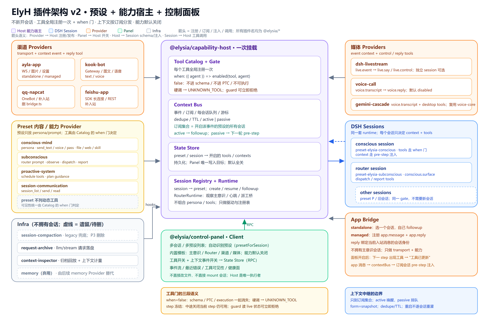

# ElyH 插件架构 v2：预设、能力宿主与控制面板

> 状态：设计稿，2026-11-21。范围：现有 15 个 `@elysia/*` 插件、两个基础会话，以及为它们服务的新核心包。
> 目标不是重写所有协议，而是把"谁拥有会话"和"谁提供能力"分开。
> 关键约束：**不新开会话**；工具热加载；上下文中继；能力默认关闭；向"所有开启该事件的预设对应的所有会话"分发。



*图：PNG 由 [HTML](elyh-plugin-architecture.html) 渲染。*

## 1. 结论

采用四层：

1. **Preset**：会话出生时的人格、提示词文件、基础上下文。只决定"是谁"。
2. **Capability Host**：全局能力宿主，负责工具注册与 `when` 门、上下文事件总线、开关状态、会话注册表。
3. **Control Panel**：客户端面板，负责多会话/多预设的开关、模板、事件日志和健康面。
4. **Providers**：渠道、媒体、工具、上下文、基础设施插件。它们只注册能力，不拥有主意识/Router 会话。

会话仍然是 DSH 的普通 Session。能力和上下文在运行期按会话集合生效，不需要新会话。

## 2. 核心模型

### 2.1 Agent 与 Runtime

- **Agent = context + tools**。模型能看到的只有这两类东西；模型、loop、session、inbox、权限、持久化是所有 Agent 共享的 runtime。
- **Preset** 管 context 的基线（persona、standing prompts、time）；能力默认值由面板模板写入 State Store，预设本身不列动态工具。
- **Capability Host** 管运行期的 context 事件和 tool 可见性。
- **Session Runtime** 管创建/恢复、把入站消息 followup 到会话、观察、唤醒。
- **Control Panel** 只读写 Host 的状态，不直接改会话文件，也不直接 mount 会话级插件。

### 2.2 为什么不每个会话挂 ToolPack

每个会话挂一个 ToolPack 会把"全局能力 + 每会话开关"做成"每会话安装"：

- 开关要逐会话 mount/unmount；
- 重启要逐会话补挂；
- 多会话时生命周期复杂；
- 工具定义重复，schema/缓存容易漂移。

正确形态是：**工具全局注册一次，`when` 按会话判定；上下文全局监听一次，按订阅分发。** 这也是 DSH 中 plan-mode、MCP client、skill 工具已经在用的模式。

## 3. 组件

### 3.1 `@elysia/capability-host`（Host 插件）

一次挂载，持有四块：

| 模块 | 职责 |
|---|---|
| Tool Catalog | 收集 Provider 注册的工具描述与工厂；每个工具全局 `ctx.tools.register(def, { when })` 一次 |
| Gate | `enabled(toolId, agent)`：按会话集合或预设集合判定；失败关闭 |
| Context Bus | 事件 schema、订阅、每会话队列/游标、去重、TTL、主动/被动分发 |
| State Store | `presetId/sessionId -> 开启的 tools/contexts`，持久化；面板的唯一写入目标 |
| Session Registry | 会话 -> 预设映射；可读 `agentPresets.presetForSession(session)`；只读，不创建会话 |

可选子模块（第一期可后置）：

- `RouterRuntime`：观察主意识 session 事件，向 Router 发布 `conscious.surface` 上下文；心跳；派工/报告桥。
- `InboundRouter`：渠道消息 -> 目标会话 `followup`。
- `SessionRuntime`：只负责创建/恢复会话，不组合提示词或工具。

### 3.2 `@elysia/capability-host` 的 Client 半

- 列出会话与预设，自动识别当前会话的预设。
- 内置几套能力模板（主意识、Router、渠道、媒体）。
- 开关工具和上下文事件；默认关闭，显式开启才写入 State Store。
- 显示上下文事件流、工具可见性、最近一次错误。
- 通过 RPC 读写 Host；不直接操作文件或 `agent.ctx`。
- 权限：只有 owner 可改；所有变更审计。

完整契约见 [ElyH 上下文事件 + 工具管理面板方案](elyh-control-panel.zh.md)。

### 3.3 Presets

- `preset-elysia-conscious`：SOUL/USER/MEMORY/CONSCIOUS-MIND、当前时间、人格；默认能力由 State Store 决定。
- `preset-elysia-subconscious`：SOUL/USER/MEMORY/SUBCONSCIOUS-ROUTER、当前时间；默认能力同样由 State Store 决定。
- Preset 本身不列动态工具；动态能力全部经 Host 的 `when` 门。这样不会出现"预设里一份、面板里一份"的双源。
- 旧会话没有 preset 记录也没关系：能力门按 session id 工作，旧会话照样能收到新工具/上下文。

### 3.4 能力契约

```ts
interface ToolDescriptor {
  id: string
  factory: (ctx) => ToolDefinition
  schemaVersion: string
  requires: string[]        // host services
  permissions?: string[]
  ui?: { title: string; description: string }
}

interface ContextEvent {
  id: string
  kind: string              // e.g. app.message, conscious.surface, live.event
  source: string
  summary: string
  payload: unknown
  visibility: { presetIds?: string[]; sessionIds?: string[] }
  active: boolean           // true: wake a turn; false: next pre-step
  dedupeKey: string
  ttlMs?: number
}

interface CapabilityBinding {
  presetId?: string
  sessionId?: string
  tools: string[]
  contexts: string[]
}
```

## 4. 工具加载

### 4.1 全局注册 + 条件门

每个工具只注册一次：

```ts
ctx.tools.register(def, {
  when: ({ agent }) => host.enabled('app_reply', agent),
})
```

`when` 每个 step 评估一次，条件收到 `{ agent, modelSelection, signal }`。false 时：

- 不进入 executor 的工具描述；
- 不进入 PTC 绑定；
- 不能执行。

`enabled()` 支持两种集合：

- **精确会话**：`allowedSessions.has(agent.session.id)`。
- **预设集合**：`allowedPresets.has(presetForSession(agent.session))`；该预设以后新建的会话自动包含。

默认关闭；面板开启只是改 State Store 里的集合。

### 4.2 硬阻断语义

| 场景 | 当前 step | 下一 step | 执行 |
|---|---|---|---|
| step 开始时条件 false | 无 schema | 仍无 | 模型硬调 -> `UNKNOWN_TOOL` |
| step 开始时条件 true | 有 schema | 取决于下一次评估 | 可执行 |
| step 中途关闭 | 当前 step 已冻结 | 消失 | 当前 step 仍可能执行；可加 guard 立即拒绝 |
| 全局 dispose | 未开始调用拒绝 | 消失 | 已开始调用按取消契约 |
| `tools.restrict` | 从 prompt 与执行中一起消失 | 同 | 与不存在不可区分 |

要"关了连当前 step 也不能调用"，在 `when` 之外加调用时检查：

```ts
ctx.tools.guard(exec => {
  if (exec.name === 'app_reply' && !host.liveEnabled(exec.agent, 'app_reply')) {
    return 'app_reply 已关闭'
  }
})
```

`when` 是 step 级门，`guard` 是调用级门；两层都要。

### 4.3 工具更新提示

工具集变化后，agent loop 在下一请求比较 request header，写 `developer/message` 的 `tool-addition` / `tool-removal`。Chat 显示"工具已更新"；Trajectory 显示请求级变化。`tools/change` 不是这条提示的来源，它只是注册表通知。

### 4.4 重工具/惰性加载

如果工具实现很重，只在有人开启时才想加载：

- 全局 Provider 在首次启用时 mount，最后一个关闭时 dispose；
- 工具仍全局注册一次，`when` 控制可见性；
- 仍然不是每会话一份。

## 5. 上下文中继

### 5.1 事件与订阅

Provider 向 `contextBus.publish(event)` 发事件。Host 按订阅解析出目标会话集合：

- 预设订阅：该预设的所有会话；
- 会话订阅：精确会话；
- 事件自带 visibility 作为二次过滤。

"所有会话"的准确含义是：**所有开启了这个事件的预设对应的所有会话**，不是字面全库。

### 5.2 主动与被动

- **被动**：只让会话知道，下一次 `agent/pre-step` 注入；不唤醒。
- **主动**：除注入外，`agent.followup(...)` 唤醒一轮；消息 `source.kind` 标明触发来源。

### 5.3 注入

一个全局 `agent/pre-step` 监听器，按 agent 取队列：

1. 取该会话未消费的事件；
2. 生成一条 snapshot，`source.kind = 'elysia-context-relay'`，`form: 'snapshot'`；
3. 用 `surfaceOp: 'replace'` 清掉上一轮同源旧快照；
4. 标记已消费；`dedupeKey` 防重复。

`form: 'snapshot'` 让 subconscious 的 `isExternalInput` 忽略它，不会把注入当新的外部输入。

### 5.4 新会话与重启

- 新会话：预设订阅立即生效；未来事件会收到。历史事件是否补发由 `ttlMs/backlog` 决定。
- 重启：Host 插件挂载一次，读 State Store；全局监听和工具条件自动恢复。**没有逐会话重新注入这一步。**

## 6. 全插件迁移

| # | 插件 | 现有职责 | v2 角色 | 目标形态 | 阶段 |
|---|---|---|---|---|---|
| 1 | `conscious-mind` | 主会话、pending、turn、工具、提示词 | 预设内容 + 工具 Provider | `preset-elysia-conscious` + `tool-*` + `@elysia/inbound-router`；删除 `main-session.ts`/`pending.ts`/`turn.ts` | P1 |
| 2 | `subconscious` | 观察、SQLite、Router、记忆、派工 | Router 预设 + Host runtime | `preset-elysia-subconscious` + `@elysia/router-runtime`；记忆 worker 后置 | P2 |
| 3 | `session-communication` | 三会话通信 | 通信工具/服务 | `session_list/send/read` 注册进 Catalog；参与者可配置，不写死 | P2 |
| 4 | `session-compaction` | 旧会话补原生压缩 | Legacy 兜底；新预设自带压缩组后删除 | 预设内挂 `compaction-basic` + `command-compact` + `tool-result-pruner`；本插件 P3 删除 | P3 |
| 5 | `proactive-system` | plan tools/host | 工具/上下文 Provider | schedule 工具 + guidance 注册进 Catalog；不拥有会话 | P2 |
| 6 | `memory` | 空占位 | 删除 | 移除；记忆读写由后续 memory Provider 提供 | P3 |
| 7 | `ayla-app` | Ayla 渠道 + 设置 | Channel Provider | `ayla.message` 上下文 + `ayla.reply` 工具；standalone/managed 两模式 | P3 |
| 8 | `kook-bot` | KOOK 渠道 | Channel Provider | `kook.message` + `kook.reply`；图文/语音能力位 | P3 |
| 9 | `qq-napcat` | QQ 渠道（半截） | Channel Provider | 补入站；删除 `bridge.ts`；`qq.message` + `qq.reply` | P3 |
| 10 | `feishu-app` | 飞书渠道（半截） | Channel Provider | 补入站；SDK 路径配置；`feishu.message` + `feishu.reply` | P3 |
| 11 | `request-archive` | 请求归档 | Infra | 保持 `llm/stream` 钩子 | P0 |
| 12 | `context-inspector` | 归档回放 UI | Infra + 面板入口 | 保留 `conversation.view`/仪表；可选接入面板的会话诊断 | P2 |
| 13 | `dsh-livestream` | 直播上游移植 | Media Provider | `live.event` 上下文 + `live.say`/`live.control` 工具；独立 session 可选 | P4 |
| 14 | `voice-call` | 实时语音 | Media Provider | `voice.transcript` + `voice.reply`；抽 `@elysia/voice-core` | P4 |
| 15 | `gemini-cascade` | 语音/桌宠 | Media Provider | 复用 `@elysia/voice-core`；`voice.transcript` + 桌面工具 | P4 |

### 6.1 新增核心包

- `@elysia/capability-host`：Tool Catalog、Context Bus、State Store、Gate、Session Registry，以及同包的 Client 面板。
- `@elysia/router-runtime`：观察主意识、心跳、派工桥；可后置。
- `@elysia/inbound-router`：渠道消息 -> 目标会话 followup；可先并入 Host。
- `@elysia/channel-kit`（库，不是插件）：standalone 渠道的最小会话/发送工具。
- `@elysia/voice-core`（库，不是插件）：VoiceAgent/persistence，供 voice-call 与 gemini 共用。

### 6.2 硬规则

- 只有 `SessionRuntime` 创建/恢复会话；Provider 不创建主意识/Router 会话。
- Preset 不列动态工具；动态能力由 Host 的 `when` 门决定，避免双源。
- Provider 不 runtime-import 另一个 feature plugin 的值；共享代码进中性库。
- 所有工具/上下文 Provider 都可独立挂载；缺 Host 时降级或明确失败。
- Panel 是唯一写入 State Store 的 UI；Host 是唯一执行者。

### 6.3 实施阶段

- **P0 · 契约与骨架**：`capability-host` 的 Tool Catalog/Gate、Context Bus、State Store、Session Registry；同包的 Client 半只读列表；不改变现有行为。验收：`when` 条件、`UNKNOWN_TOOL`、订阅分发、持久化各有单测和真实组合测试。
- **P1 · 主意识 + App Bridge**：`preset-elysia-conscious`、主意识工具 Provider、`inbound-router`、`app-bridge` 两模式。验收：已有会话加工具不新开、关闭不可执行、app 消息触发一轮、回复工具绑定入站会话。
- **P2 · Router + 内部能力**：`preset-elysia-subconscious`、`router-runtime`（观察/心跳/派工桥）、`session-communication`、`proactive-system`。验收：主意识事件进入 Router 上下文；Router 派工不依赖固定 session id；报告回传。
- **P3 · 渠道 + 记忆**：`channel-ayla/kook/qq/feishu` 统一为 Provider；补 QQ/飞书入站；删除 `memory` 空占位；记忆读写 Provider 先做只读。验收：四个渠道都能 managed 注册上下文/回复工具；订阅集合分发正确。
- **P4 · 媒体**：`livestream`、`voice-call`、`gemini-cascade` 抽 `voice-core`；standalone 模式保留独立会话，managed 模式只注册事件/工具。验收：媒体能力不反向依赖主意识插件。

每个阶段都必须有：Provider 独立挂载/卸载测试、Host 组合测试、至少一条真实 Session 的端到端测试。不能只用手搓 `ctx.plugin(...)` 的单测代替真实组合。

### 6.4 原生压缩归属

标准 Web preset 已经把压缩放在 Agent 组里（`compaction-basic` + `command-compact` + `tool-result-pruner`）。ElyH 的两个 preset 应该直接复制这一组，而不是继续靠 `session-compaction` 在每个 `agent/created` 上补：

```yaml
- id: compaction
  name: cordis:group
  group: true
  isolate:
    compaction: true
    toolResultPruner: true
  config:
    - id: compaction-basic
      name: '@deepseek-ai/dsh-compaction-basic'
      config: { auto: false }   # 主意识保持手动；Router 可 auto: true
    - id: command-compact
      name: '@deepseek-ai/dsh-command-compact'
    - id: tool-result-pruner
      name: '@deepseek-ai/dsh-compaction-tool-result-pruner'
      config: { thresholdChars: 8192, headChars: 4096, tailChars: 1024 }
```

这样：

- 新会话出生就有完整压缩，不需要 `session-compaction`。
- 主意识仍是手动压缩；Router 可以自动压缩。
- `session-compaction` 只对"不是从 preset 创建、也没有压缩组"的旧会话有意义；而且它只补 engine + command，不补 `tool-result-pruner`，本来就不如 preset 完整。
- 如果决定保留旧会话，它是 P3 之前的兜底；如果没有旧会话，P3 直接删除。

## 7. 关键流程

### 7.1 给现有会话加工具（不新开）

1. 面板为预设/会话打开 `app_reply`。
2. State Store 写入。
3. 下一次 step 准备时，`when` 重新评估为 true。
4. 工具进入 schema；agent loop 记录 `tool-addition`；Chat 显示"工具已更新"。
5. 模型调用；执行层按当前 step 的 ResolvedToolSet 放行。

### 7.2 关闭工具

1. 面板关闭。
2. 下一 step `when` false；schema/执行一起消失。
3. 未开始调用拒绝；已开始按取消契约。
4. 需要当前 step 立即拒绝：`guard` 读 live 状态。

### 7.3 上下文事件分发

1. App Bridge 收到消息，`contextBus.publish(app.message)`。
2. Host 解析订阅：主意识预设的所有会话 + 任何显式订阅的会话。
3. 被动事件入队；主动事件 `followup`。
4. 每个目标会话的 `pre-step` 注入 snapshot；消费后标记。
5. 没订阅的会话不收到。

### 7.4 App Bridge 两模式

- **standalone**：选择/持有一个会话，自己 followup；不经过面板。
- **managed**：向 Catalog 注册 `app_reply` 工具，向 Context Bus 注册 `app.message`；面板把这两个能力开给主意识预设；它不拥有会话。
- 回复工具绑定当前入站消息的会话身份；模型不能自由指定 channel/conversation。

## 8. 验收

1. **不新开会话加工具**：已有会话打开 `app_reply`，下一轮出现，Chat 显示"工具已更新"。
2. **关闭即不可执行**：关闭后下一轮 schema 消失；硬调返回 `UNKNOWN_TOOL`；当前 step 由 guard 拒绝。
3. **上下文只到订阅集合**：三个会话开启、两个未开启；事件只到三个。
4. **主动/被动**：主动事件唤醒一轮；被动事件只在下一次输入时可见。
5. **重启恢复**：重启后 Host 挂载一次，State Store 恢复；不逐会话重灌。
6. **多会话/多预设**：同一工具在不同会话可见性不同；新会话按预设自动继承。
7. **App Bridge managed**：app 消息 -> 上下文 -> 主意识回复 -> app 收到。

## 9. 风险与未决

- **Preset 编辑 API 不存在**：Panel 只能写自己的 State Store，不能原地改 DSH preset 声明；若必须改预设，只能装 bundle patch，且新会话生效。
- **旧会话没有 preset**：能力门按 session id 仍可用；不要为了统一而重建旧会话。
- **多个 Router**：状态按 session id 分片；不要固定 `stateDir`/游标。
- **记忆写边界**：主意识/Router 只读记忆根；写入只给 memory Provider。
- **条件错误**：`when` 抛错会让 step 失败；必须 fail-closed 包装。
- **上下文泄漏**：订阅 + visibility 双重过滤；事件 payload 不跨会话复用可变对象。
- **性能**：`when` 每 step 评估；集合查询要 O(1)，不要扫全部会话。
- **工具代码热更新**：热的是注册/可见性，不是实现代码；改实现要重载插件。
- **权限**：Panel 是管理员面；owner 鉴权 + 审计；工具注册不等于授权。
- **缓存**：工具/上下文变化会使前缀缓存从变化点失效；这是正确代价。

## 10. 参考

- [DSH tools：conditional tools](../../dsh/packages/core/tools/README.md)
- [DSH agent-loop：tool updates](../../dsh/packages/core/agent-loop/tests/tool-updates.spec.ts)
- [DSH plan-mode：`exit_plan_mode` 全局注册 + when](../../dsh/packages/plan/plan-mode/src/index.ts)
- [DSH MCP client：syncTools 整代注册/注销](../../dsh/packages/mcp/mcp-client/src/tools.ts)
- [DSH preset registry：会话记录 preset，编辑只影响新 Agent](../../dsh/packages/preset/agent-preset-registry/README.md)
- [现有 current-time：pre-step 注入快照](../../plugins/conscious-mind/src/current-time.ts)