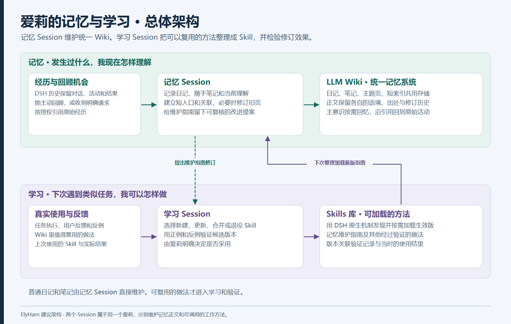
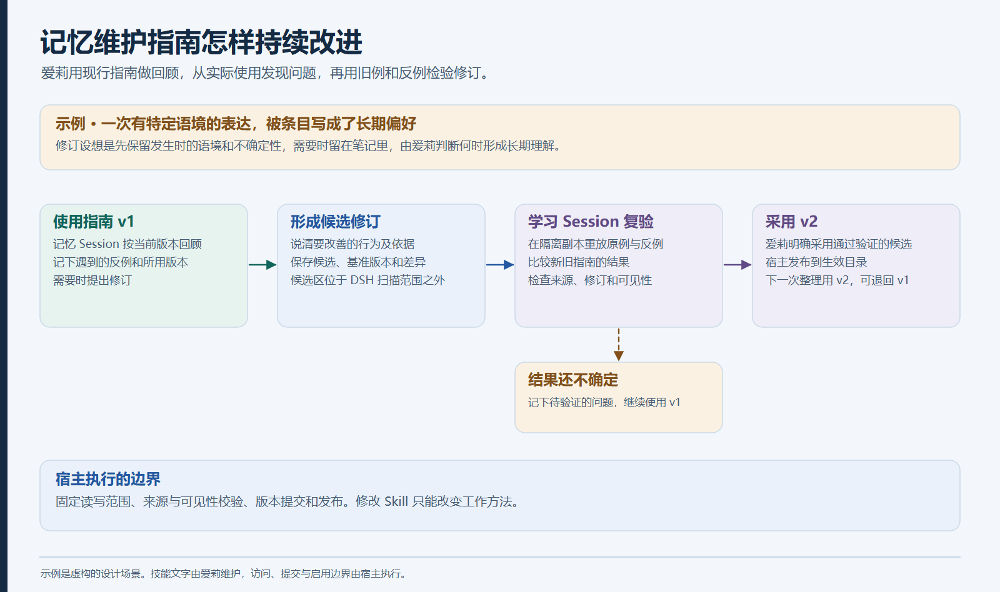

# 爱莉的 LLM Wiki、记忆与学习

讨论记录 · 2026-11-18

当前方向是把 **LLM Wiki 作为爱莉的统一记忆系统**。日记、笔记、认知主题页和她自己写的短索引共同维护在这个体系里。长期 `memory` Session 的首要职责是整理这份 Wiki。未来的 `learning` Session 主要维护 Skills 库，第一项适合验证的技能是 Wiki 维护指南。下面记录的是设计方向和建议的实施顺序。

## 统一记忆

| 内容 | 保存什么 |
| --- | --- |
| DSH 原始历史 | 当时发生的会话与工具活动。Wiki 用获准的稳定引用回到原记录。 |
| Wiki 中的日记和笔记 | 爱莉当时的感受、理解、尚未展开的想法和回顾线索。 |
| Wiki 中的认知主题页 | 爱莉当前的理解、适用情境、例外与尚待确认的问题。可以关联多段经历。 |
| Wiki 中的短索引 | 爱莉亲自写的回忆入口。主意识按需找入口，读正文并回查获准材料。 |

新日记、笔记和认知页走同一套记忆维护流程。已有日记与笔记可以先用稳定引用纳入同一索引，迁入时保留原文、原时间和出处。目录、文体、取舍、关联和修订由爱莉决定。宿主负责来源与访问校验、版本冲突、原子提交和恢复。爱莉写下的正文与修订历史作为记忆原文持久保存，供搜索使用的技术索引可以重建。

主意识在对话中按需调用记忆，用户此刻明确表达的意思优先于旧理解。可见性覆盖标题、短入口、正文、旧版本、引用和实际进入会话的内容。建议首版限定一个获准的可见性域。

## 两个长期 Session

- **记忆 Session**接收获准的回顾材料。爱莉决定记录、修订、关联或暂不整理，普通日记和笔记直接由它维护。主意识可以提出回顾和修订建议。
- **学习 Session**从真实使用、反馈和反例中发现可改进的方法。它起草、验证、更新或退役 Skill。反思产生的新理解写回 Wiki，可反复检验的工作方法才进入 Skills 库。
- **宿主**执行权限与发布边界。Skill 可用后由相关 Session 按需加载。技能验证可以先作为学习 Session 的有界步骤。

## 爱莉维护自己的 Wiki 指南

起始指南保持简短，说明怎样回看来源、关联已有页面、保留语境与不确定性，以及怎样修订。实际整理中发现问题时，记忆 Session 可以提出 `SKILL.md` 修订，附上基准版本、期望改变的行为和可复核案例。学习 Session 用原例与反例在隔离副本上比较新旧指南。爱莉明确采用具体版本后，宿主发布，后续整理任务再加载新版。证据还不足时，保留候选及待验证问题，继续使用现行版。

Spark 已有 DSH 原生 Skill 目录和加载机制。候选稿应放在扫描目录之外，受控发布把已采用版本写入生效目录。每次整理固定所用指南版本，退化时可以切回上一版。读写范围、可见性、版本提交和启用权由宿主执行。

## 建议的实施顺序

1. 用一个获准的资料域和隔离样本跑通统一 Wiki。验证爱莉能写日记与笔记、从另一个会话找回条目，并在新经历出现后修订同一页。核对引用、旧版、并发冲突和重试结果。
2. 复用现有记忆 Session 和派工闭环交付有界回顾任务。让主意识能提出回顾，并控制每次送给记忆 Session 的材料范围。
3. 把 Wiki 维护指南作为学习 Session 的首个案例，验证候选、对照测试、采用、发布和回退。用真实的使用结果判断改进是否成立。

Spark 当前可复用的基础包括已装配的固定记忆 Session、主意识的原生 Skills 加载能力，以及派工文档第 20 节记录的「Router 派工、记忆 Session 写日记、Report 回传」实测。`@elysia/memory` 的 README 仍将其列为占位。统一 Wiki、学习 Session 和指南发布流程是本次讨论提出的设计。[记忆插件](../../../plugins/memory/README.md) · [记忆 Session 需求](../../../plugins/subconscious/sessions/memory/REQUIREMENTS.zh.md) · [派工与验收](../../../plugins/subconscious/DISPATCH.zh.md) · [主意识 Skills](../../../plugins/conscious-mind/SKILLS-PLAN.zh.md)

待确定的事项是 `MEMORY.md` 与 Wiki 短索引的分工、旧文件纳管方式、哪些回顾适合经 Router 触发，以及谁作为爱莉的授权窗口采用 Skill 的正式版本。

## 讨论演进与图稿

最初从 `nashsu/llm_wiki` 的原理和桌面架构出发，讨论过用只读快照给爱莉查工程资料。随后定位改为爱莉亲自维护的个人认知手册。最新方向进一步把日记和笔记并入同一 Wiki，并让记忆、学习两个窗口通过维护指南和使用反馈协作。借鉴的是原始来源可回查、Markdown 页面可链接和持续修订的方式。[LLM Wiki 原始设计](https://gist.github.com/karpathy/442a6bf555914893e9891c11519de94f) · [nashsu/llm_wiki 实现](https://github.com/nashsu/llm_wiki/tree/e08cfce65aad8b76b13546a081c1a8d4422b70c3)

| 图稿 | 适用范围 | 文件 |
| --- | --- | --- |
| 爱莉的记忆与学习总体架构 | 最新方案 | [PNG](diagrams/architecture.png) · [SVG](diagrams/architecture.svg) |
| 记忆维护指南怎样持续改进 | 最新方案 | [PNG](diagrams/guide-lifecycle.png) · [SVG](diagrams/guide-lifecycle.svg) |
| 一条记忆如何形成、使用与修订 | 认知手册示例，仍适用于统一 Wiki | [PNG](diagrams/cognition-lifecycle.png) · [SVG](diagrams/cognition-lifecycle.svg) |
| 爱莉的个人认知手册接入架构 | 中间方案，日记与笔记随后并入同一 Wiki | [PNG](diagrams/cognition-architecture.png) · [SVG](diagrams/cognition-architecture.svg) |
| LLM Wiki 的原理 | 原始模式 | [PNG](diagrams/principle.png) · [SVG](diagrams/principle.svg) |
| nashsu/llm_wiki 的架构 | 上游桌面项目 | [PNG](diagrams/repository-architecture.png) · [SVG](diagrams/repository-architecture.svg) |
| 给爱莉接入 LLM Wiki | 早期工程资料库提案 | [PNG](diagrams/elyharn-integration.png) · [SVG](diagrams/elyharn-integration.svg) |
