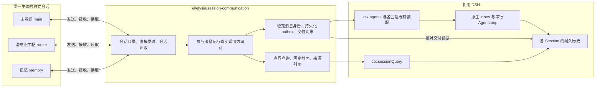

# Session 通讯插件架构说明

插件已在 Spark 的 ElyHarn Web 启用。当前代码已装配三个工具、持久消息投递和会话查询适配。

## 1. 参与者与能力

第一版覆盖同一持续主体的三个独立 DSH Session。

| 别名 | Session ID | 现有职责 |
|---|---|---|
| main | `elysia-conscious-mind` | 主意识与对外表达 |
| router | `elysia-subconscious-router` | 潜意识中枢与协调 |
| memory | `elysia-subconscious-memory` | 回顾经历、维护日记和记忆笔记 |

三者具有对等的内部通讯入口，可以相互发消息和查看彼此获准的会话信息。主意识可以直接找记忆，记忆也可以直接回复主意识。Router 是独立参与者，可以主动沟通或被询问。任何一条会话间消息都由通讯插件交付。

工具名为 `session_list`、`session_send` 和 `session_read`，字段及限制见 [需求文档](REQUIREMENTS.zh.md)。

## 2. 架构图

下图是可编辑的架构源图，生成图片与本文矛盾时以本文和已确认需求为准。

## 3. 会话目录

参与者登记保存稳定别名、Session ID、显示名称及该会话既有的创建与恢复入口。工具调用方从真实执行上下文取得，模型参数只指定目标和消息。

第一版的 main、router、memory 默认相互可发现、可发送、可读取。它们继续保留各自工作目录、提示词、工具和历史。以后加入其他会话时，通过参与者登记扩展通讯集合。

目标当前未运行时，交付层向该目标的宿主取真实会话，而不是按 session header 里的 preset 做通用恢复：Router 与记忆分别调用 `subconsciousRouter.session.ensureAgent()` 与 `.memory.ensureAgent()`，主意识仍由 conscious-mind 宿主预热后返回。这条契约是必要的——记忆会话的 header 没有 preset，通用恢复会把记忆身份组装成 standard preset（bash / subagent / web 全部可用），既破坏身份也破坏派工。目录信息区分在线、忙碌、冷存储和恢复失败。

## 4. 消息交付

`session_send` 提交普通内部消息。宿主保存消息身份与待交付记录，再把正文交给目标的 DSH inbox。第一版建议默认排到下一轮，目标空闲时由原生会话运行机制唤醒。需要把输入送进当前步骤的能力，可在需求审定后复用原生 `steer()`。

模型可以自行决定回复，回复也是一条带 `reply_to` 的内部消息。读取、工程回执和状态更新不会自动产生模型回复。自然结束使用 DSH 自己的轮次机制。

每条消息至少保留稳定消息 ID、发送者、接收者、实际发送来源、创建时间和可选的回复关系。消息正文与附件身份在重试中保持稳定。

交付事实分开记录。

| 事实 | 可用证据 |
|---|---|
| 插件已接受发送 | 消息与 outbox 记录已持久化 |
| 目标已接收入箱 | 原生 inbox 已接受对应消息身份 |
| 目标已落入会话历史 | 对应 `user/message` 的 Session 与事件序号 |
| 实际进入模型请求 | 与该消息关联的实际请求记录 |
| 目标作出回复 | 新消息明确引用原消息身份 |
| 某项工作完成 | 该工作的真实结果与验收证据 |

发送成功返回已经证实的交付层级。宿主不会用 `whenIdle()` 推断特定消息已经被阅读或执行。未知结果先查 inbox、历史和 outbox，再决定是否重发。模型回复失败与原消息交付失败分别恢复。

## 5. 会话读取

`session_read` 让参与者按需查看目标状态、近期对话或具体事件。查询复用 DSH 的实时优先读取，目标离线时读取其持久历史。一次读取标明目标 Session、读取截面和实际返回的事件范围。

可读的通讯视图包括普通消息、可见回复、工具调用、工具结果和相关来源。超出当次输出预算的内容提供稳定续读位置。读取当前正在运行的会话时，后续新事件进入下一次读取，已有返回保持对应原来的截面。

读取不会唤醒目标、向目标插入消息或推进接收系统的消费游标。读取工具返回的内容属于调用方本轮工具结果，并保留被读取 Session 与事件引用。

记忆会话仍使用自己的原生文件工具查日记和笔记。读取另一会话的历史与读取记忆工作区是两条各自有来源的能力。

## 6. 原生能力与适配工作

### 6.1 通讯

当前 DSH 的 `send_message` 通过同一子代理树查找目标，忙碌目标收到的是 `steer`。三个独立 Session 需要由本插件的参与者目录连接。

当前实现复用 `ctx.agents`、`agent.followup()` 与原生持久 inbox。各目标的创建、恢复和工具装配归现有会话入口拥有；本插件只依赖宿主暴露的 `ensureAgent()` 与 `store.resting()`，不直接调用 `sessionController.resolveAgent`。

### 6.2 历史

`ctx.sessionQuery` 已提供 `listSessions`、`readSurface`、`readEvent`、`filterEvents` 和追踪能力。读取持久会话可以保持目标离线。

DSH 原生模型历史工具使用严格相等的 `header.cwd` 判断跨会话访问。三者工作目录不同，本插件须从真实调用方及已登记参与者确定可读目标，再调用原生查询服务。

当前 Web 全文搜索配置为 `openAt: never`。首版可以先使用精确读取和字面过滤。全文索引的启用属于独立配置事项。

## 7. 与信息收集系统的关系

内部消息使用明确的来源类型、消息身份、发送者、接收者和回复关联。进入主意识的内部消息可以留下实际接收事实，但始终保留内部来源。

收集系统可以记录真实通讯工具调用和结果，并通过关联引用连接。查询返回本身保持工具结果身份。读取历史、处理回执和投递对账均不自行触发重新发送，避免循环复制旧事件。

## 8. 第一版验证边界

先验证 main、router、memory 的目录、直接发送、直接回复和有界会话读取。通讯插件只负责消息与查询，不自动把普通消息转换成派工、长期记忆或渠道外发。

当前插件配置包含必需的 `stateDir` 和默认 256 的 `maxPending`。Spark Web 启用状态和爱莉实际调用证据见 [验收记录](README.md#spark-web-实际验收)。具体能力和验收以 [需求文档](REQUIREMENTS.zh.md) 和 [数据流](DATAFLOW.zh.md) 为准。

原生图片和文件引用仅可从发送者自己的 `user/message` 中取得，并经原生附件存储核验。历史互读返回附件身份供理解和追溯；它本身不会把该附件写入调用者的接收历史。
