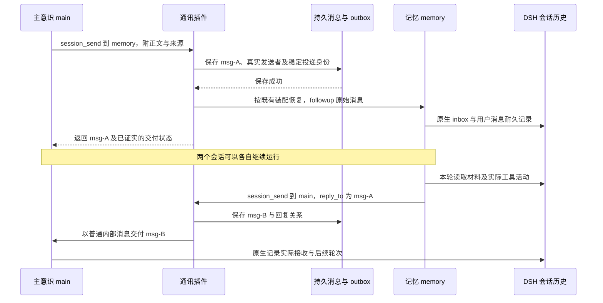
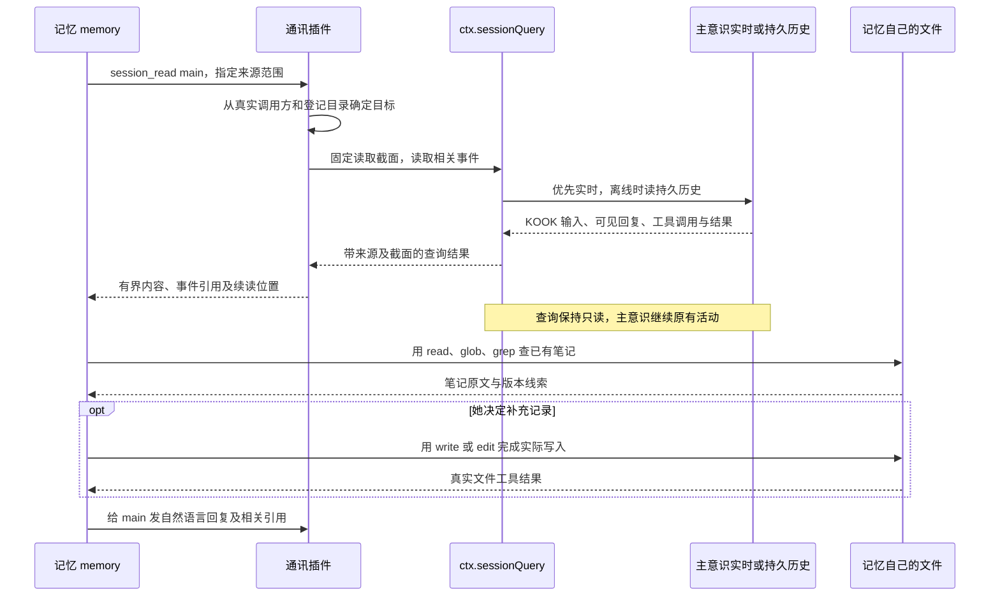
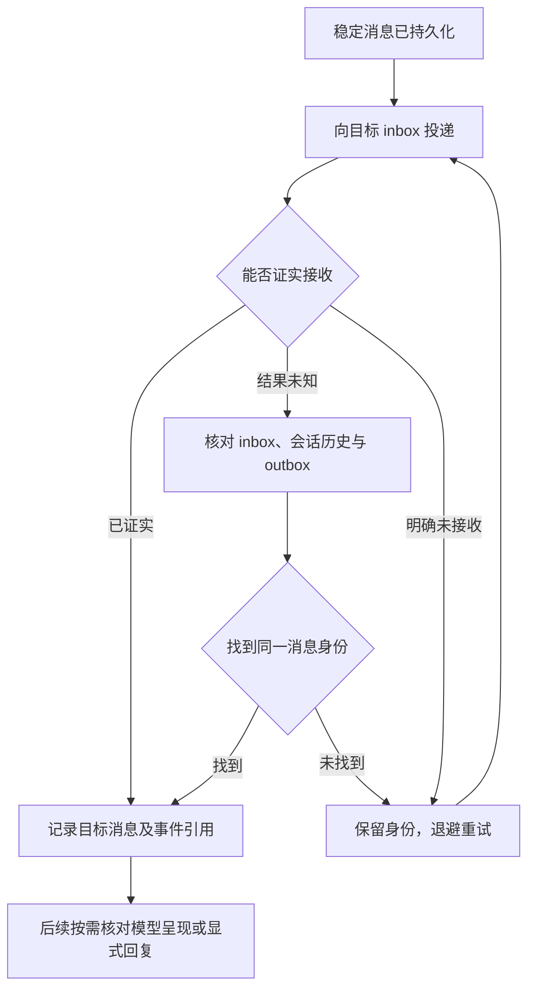

# Session 通讯插件数据流与验收说明

插件已在 Spark 的 ElyHarn Web 启用。下面保留合成 KOOK 对话示例。实际模型调用和投递证据见 [验收记录](README.md#spark-web-实际验收)。

## 1. 示例材料

假设主意识已收到一段 KOOK 对话，先约定“明晚八点见”，随后地点被改为“东门”。主意识自己的 Session 已保存对应输入、可见回复、一次 `send_text` 调用及其真实结果。

主意识希望记忆会话核对这段经历，并结合已有笔记判断怎样整理。示例中的 `S-main:120`、`S-main:126` 等是说明引用格式的占位值。

| 对象 | 示例 |
|---|---|
| 请求消息 | `msg-A` |
| 发送者 | main |
| 接收者 | memory |
| 请求正文 | “请回顾这次见面约定，并查看已有笔记是否需要补充。” |
| 来源 | 主意识会话中的 KOOK 输入及相关工具记录 |
| 回复消息 | `msg-B`，明确引用 `msg-A` |

消息可以随附当前材料和来源引用。接收方按需要查原始会话上下文，也可以读取自己的既有笔记。

## 2. 直接发送与回复

Router 可以参与同一通讯集合。上图中的直接请求和回复不需要先进入 Router 的派工队列。若主意识选择请 Router 协调，它也可以直接把请求发给 Router。

`session_send` 的交付回执只描述已发生的工程事实。记忆是否已经看见、回复或写入文件，分别由后续真实事件证明。

## 3. 按需读取目标会话

记忆拿到 `msg-A` 后，可以直接查看主意识的相关历史。该读取独立于主意识当前是否正在思考。

此例中，她能分别核对三份材料。

- KOOK 来源实际说了什么。
- 主意识实际回复、调用工具和收到结果的记录。
- 自己以前怎样记录过这段经历。

`send_text` 的工具返回与平台最终回执分别保留各自来源。平台回执存在时可以关联读取，缺失时据实说明。记忆文件写入结果也可附在回复中，供主意识按需要查证。

## 4. 读取本身的数据形态

读取操作至少返回以下信息，实际字段名称在工具 Schema 审定时确定。

| 信息 | 用途 |
|---|---|
| 目标 Session ID | 明确内容来自哪个会话 |
| 读取截面 | 标明本次最多观察到哪个事件 |
| 事件序号与类型 | 找回普通输入、可见回复、工具调用和结果 |
| 实际返回范围 | 表达这次读取的大小 |
| 完整或部分标记 | 让模型知道是否还有材料 |
| 续读引用 | 在同一截面继续取后续内容 |
| 关联引用 | 连接消息、调用、结果和原始来源 |

当主意识继续追加事件，记忆已读取的材料仍对应原截面。之后可以从新位置读取新增事件。来源会话的当前表层经过 Compact 或替换时，读取接口应能说明它返回的是当前可见内容还是精确历史事件。

## 5. 故障恢复

目标离线时先走它原有的恢复入口。恢复失败保留错误与待交付记录。已经接收后的模型失败不使宿主复制原消息。若需要继续处理，沿同一消息关系发起明确的后续输入。

读取失败可以重新查询，读取操作始终不向目标插入消息。读取取消与消息发送取消分别记录到各自操作。

## 6. 首版验收例子

1. 主意识直接发一条合成请求给记忆，记忆直接回复主意识，两边历史均有真实来源。
2. Router 可以分别给主意识和记忆发消息，目录中三者状态与实际运行状态一致。
3. 记忆读取主意识的合成输入、工具调用和工具结果，主意识不因查询产生额外轮次。
4. 主意识可以读回记忆的对应可见回复与文件工具结果。
5. 同一消息重试保持身份，进程中断后先对账，避免重复交付。
6. 目标忙碌时普通消息按默认队列交付，读取返回固定截面。
7. 超过读取预算时返回续读引用，既有结果可追溯。
8. 挂载和卸载仅影响本插件的目录、工具和交付任务，独立会话历史继续由 DSH 保存。

完整能力边界见 [需求文档](REQUIREMENTS.zh.md)，组件关系见 [架构草案](ARCHITECTURE.zh.md)。

## 7. 当前附件与读取投影

发送文字时，正文直接进入目标的原生用户消息。发送图片或文件时，`attachment_ref.ref` 必须是发送者此前在自己 `user/message` 中收到的原生 attachmentId，通讯层通过 DSH 附件存储核验可读性后转交。

如果记忆只通过 `session_read` 看到了主意识历史里的附件身份，该读取结果仍是工具结果，当前不能直接据此把附件再次转交。实际材料需要先按原有接收入口进入发送者自己的用户消息。

历史互读保留可见正文、工具调用和结果的事件来源，清理隐藏推理、provider replay 与识别出的凭据。分页截断提供续读位置，进程重启或游标过期后从第一页重新取得快照。
