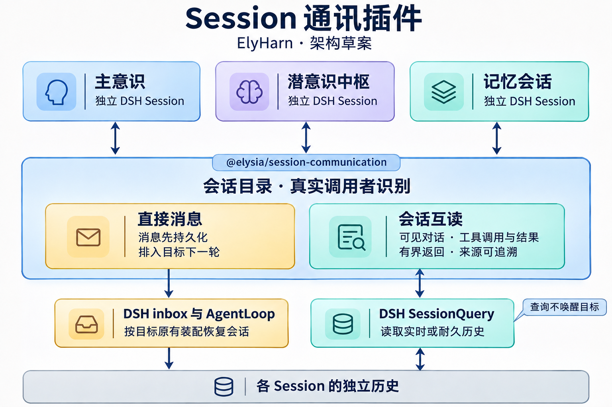
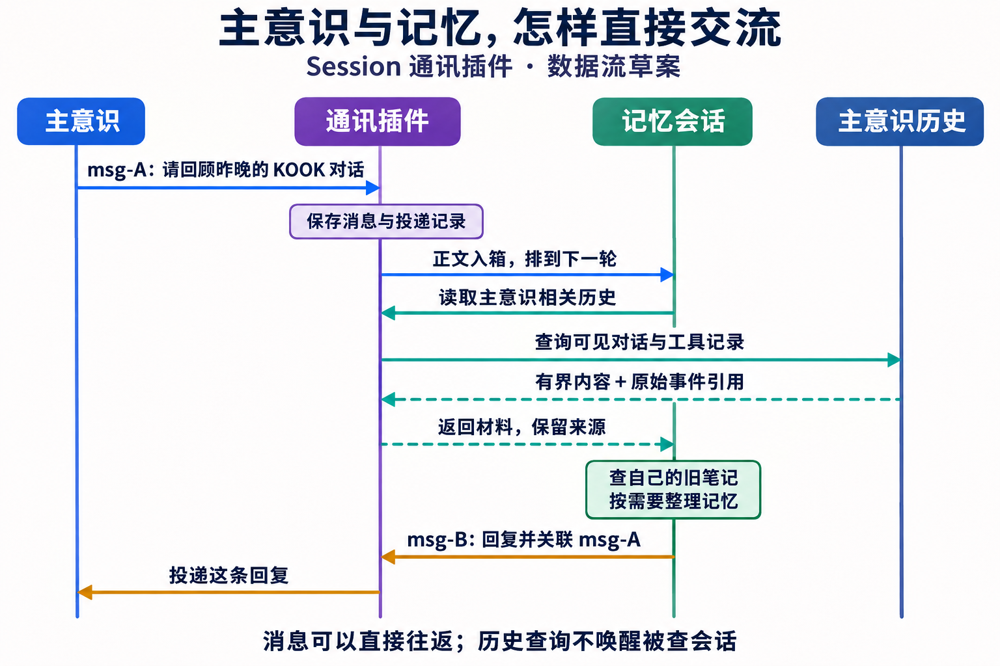

# Session Communication

插件已在 Spark 的 ElyHarn Web 启用。包名为 `@elysia/session-communication`。

插件为主意识、中枢和记忆会话提供直接双向消息与相互历史查询。三个参与者保留各自的提示词、工具、历史和工作目录。

## 当前能力

- `session_list` 列出 main、router、memory 的可确认状态和通讯能力。
- `session_send` 先持久保存消息，再交给目标原生 DSH 下一轮收件箱；回复通过 `reply_to` 关联。
- `session_read` 查看会话信息、可见历史、具体事件、字面查询及内部消息交付证据。查询不会唤醒目标。
- 消息正文支持文字和原生图片／文件附件。附件必须来自发送会话自己已收到的 `user/message`，使用其中的 `attachmentId`。读到别的会话附件元信息、拥有任意路径或 URL，都不构成本次可转交附件的来源。
- 历史视图返回可见消息、工具参数和结果，过滤隐藏推理、provider replay 数据及框架注入；识别出的凭据内容会被清理。
- 通讯存储保留稳定消息 ID、幂等身份、讨论关系、投递和原生轮次证据。未知结果先核对目标收件箱和耐久历史。
- 内部收发及其技术回声在潜意识采集层保留记录，避免重新唤醒中枢形成自动循环。

## 配置

```yaml
- id: elysia-session-communication
  name: '@elysia/session-communication'
  config:
    stateDir: /home/ayerelysia/Elysia/Data/subconscious/session-communication
    maxPending: 256
```

`stateDir` 必填，保存 `communication.sqlite`。`maxPending` 默认 256，范围 1 至 10000，用于限制未确认接收的消息总数。已存在消息的幂等重试沿用原记录。

第一版实现的是异步会话消息与历史读取。音频、视频与实时媒体可以随具体使用需要扩展。

## 文档和图示

- [需求与接口](REQUIREMENTS.zh.md)
- [架构与原生能力衔接](ARCHITECTURE.zh.md)
- [数据流与交流示例](DATAFLOW.zh.md)

下方图片来自设计阶段。可编辑的 Mermaid 图保存在对应文档中。





## 检查和验收

从项目内运行：

```sh
cd plugins/session-communication
../../dsh/node_modules/.bin/vitest run --maxWorkers=1 --no-file-parallelism
node ../../dsh/node_modules/typescript/bin/tsc --noEmit --incremental false --composite false -p tsconfig.json
```

隔离检查覆盖来源身份、查询投影、分页、幂等存储、串行投递和恢复。真实验收通过实际模型工具调用和双方的 DSH 耐久历史取证。


### Spark Web 实际验收

2026 年 11 月 18 日，爱莉在现有主意识、中枢和记忆会话里使用了 `session_list`、`session_read`、`session_send`。三组会话均完成直接往返。收件方从发送方历史中查到合成标记，再用 `reply_to` 关联原消息。原消息和回信都进入了对应模型请求，接收轮次正常结束。

| 往返 | 目标接收事件序号 | 关联回信接收事件序号 |
|---|---:|---:|
| 主意识 → 记忆 → 主意识 | 记忆 203 | 主意识 29734 |
| 主意识 → 中枢 → 主意识 | 中枢 4952 | 主意识 29766 |
| 中枢 → 记忆 → 中枢 | 记忆 239 | 中枢 5043 |

验证使用 Web 内部合成输入。记忆会话通过原有会话装配恢复。交付在宿主中留存了收件事件、模型请求和轮次结束三类证据。

文件转交通过实测。主意识转交原生文本附件，记忆在事件 283 收到同一附件引用，用原生 `read` 读取文件，把只出现在文件中的测试内容关联回信。主意识在事件 29864 收到回信。接收会话只获得已收到的那一份原生文件的读取权限。原工作区、外部文件和写入权限继续由原有策略控制。

图片转交通过实测。主意识转交原生合成图片，记忆在事件 302 收到同一图片引用，从本轮输入识别图中左右两种颜色，并关联原消息回信。主意识在事件 29891 收到回信。

真实主意识的内部收件与通讯工具事件进入收集库，相关记录直接标为已审阅，未关联到新的中枢收集任务。

如果宿主在模型请求和交付证据的写入之间中断，`session_read` 仍可从对应原生历史核对接收与轮次结束。模型呈现证据缺失时保持未知。
